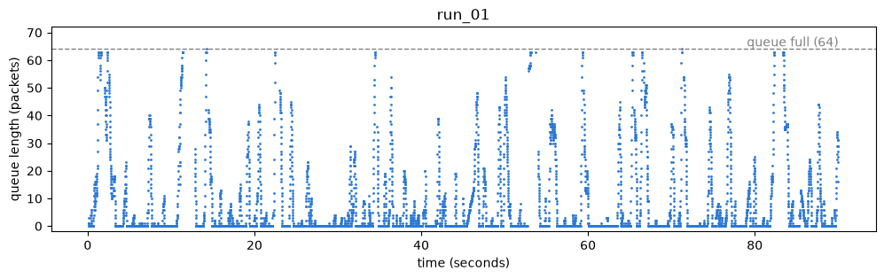
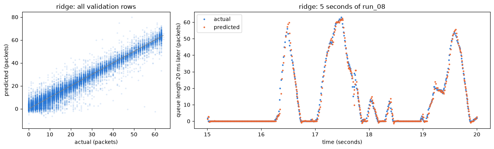

# Multi-horizon Forecasting of Switch Queue Occupancy from High-Frequency Telemetry, with Prediction Intervals

## Table of Contents

- [Members](#members)
- [I. Introduction](#i-introduction)
- [II. Datasets](#ii-datasets)
- [III. Methodology](#iii-methodology)
- [IV. Evaluation & Analysis](#iv-evaluation--analysis)
- [V. Related Work](#v-related-work)
- [VI. Conclusion: Discussion](#vi-conclusion-discussion)

## Members

- Edouard de Noblet, Mechanical Engineering, edenoblet@gmail.com
- Mohamed Ali Kabiri, Computer Science, mohamedali.kabiri@gmail.com
- Lorenzo Soubiran Frixione, Computer Science, lorenzo.soubiranfrixione@edu.ece.fr
- Zineb El Koussaimi, Computer Science, koussaimizineb@gmail.com

## I. Introduction

**In simple words:** we predict how full the queue of a network switch will be a few milliseconds from now, and how sure we are about it.

### Motivation: why are we doing this?

Packets wait in a switch like people in a checkout line. When competing traffic turns on, this queue can fill within a few milliseconds. Packets are then delayed or lost. Reacting only once the queue is full is too late, so we want to predict it before it happens.

Knowing how full a queue will be, and how sure we are about it, is a building block for networks that manage themselves.

### What do we want to see at the end?

- Models that predict the queue better than the simple guess "the queue stays as it is now" (persistence), on recordings they have never seen.
- A clear comparison: which model is best, and by how much.
- How the predictions get harder further ahead (2, 10, 20 and 50 ms).
- Not only one number but also a range, which should contain the true value about 80% of the time.

**Where we are now.** We started with one horizon (20 ms ahead) and one number per prediction. All the results below are for this step. The other horizons and the ranges are the second step: the code is in [`queue-forecasting/extras/`](queue-forecasting/extras/), and there are no results for it in this blog yet.

## II. Datasets

The data was collected by Mohamed Ali Kabiri on an emulated network testbed (BMv2 software switches in Mininet). All details are in the [data card](queue-forecasting/data/DATA_CARD.md).

### How it was recorded

- There are two switches in a row: the **bottleneck switch** and a second switch after it (the **downstream switch**).
- The output of the bottleneck switch is limited to 750 packets per second, and its queue holds at most 64 packets. When it is full, new packets are lost.
- Three background UDP flows switch between ON and OFF periods.
- Every 2 ms (500 times per second), a small measurement packet reports the depth of the queue it leaves, and how long it waited there. One such report is one **sample**.

### What is in it

| | |
|---|---:|
| recordings ("runs") | 39, of 90 seconds each |
| measurement packets sent | 1,755,000 |
| measurement packets lost | 11,875 (0.68%) |
| rows of raw data (two switches per sample) | 3,486,250 |

The raw data has these columns:

| column | meaning |
|---|---|
| `run_id` | which recording |
| `seq` | number of the measurement packet (one every 2 ms) |
| `t_ms` | receive time, in milliseconds |
| `hop` | 0 = bottleneck switch, 1 = downstream switch |
| `qdepth_pkts` | queue depth, from 0 to 64 packets |
| `qdelay_us` | time the measurement packet spent in the queue, in microseconds |



*Figure 1. The bottleneck queue in one recording. It is often empty, and sometimes it fills up quickly.*

### Train, validation and test

We made ready-to-use tables from the raw data. One row is one moment of one recording.

| table | rows | recordings | use |
|---|---:|---:|---|
| train | 196,306 | 23 | teaching the models |
| validation | 68,097 | 8 | comparing models and settings |
| test | 68,116 | 8 | only once, at the end |

We split **by recording**, because neighbouring rows are almost the same. A random split would let a model see the answers (this is called leakage).

### Things to know about the data

- **Most moments are quiet.** In about 60% of the rows the value to predict is 0.
- **Lost samples are not random.** They are mostly lost when the queue is full. A row needs 60 samples without a gap, so almost two thirds of the moments with 60 or more packets are missing from the tables. Our scores say little about completely full queues.
- **The testbed sometimes pauses**, because everything runs on one machine. We therefore count time in samples, not in milliseconds.

## III. Methodology

### The task

This is a **regression** problem: from the recent past of the queue, predict the queue length 10 samples (20 ms) later.

### Features

Each row has 15 features. They use only the past and the present, never the future.

| feature | meaning | why |
|---|---|---|
| `lag_1` ... `lag_10` | the last 10 queue lengths (`lag_1` is now) | what just happened |
| `mean_10`, `mean_50` | mean of the last 10 and 50 queue lengths | the general level, with less noise |
| `max_50` | largest of the last 50 queue lengths | was there a peak recently? |
| `slope_10` | slope of a straight line through the last 10 queue lengths | is the queue growing or shrinking? |
| `delay_now_ms` | how long the newest measurement packet waited | another view of how full the queue is |

### Models

We go from simple to complex, so that we can see what each step adds. All models come from scikit-learn.

| model | how it works | why we chose it | status |
|---|---|---|---|
| Persistence (baseline) | the queue stays as it is now | the first number to beat | scored |
| `mean_10` (baseline) | the mean of the last 10 queue lengths | a second simple guess | scored |
| Linear regression | a weighted sum of the features | the simplest trained model | scored |
| Ridge regression (`Ridge`) | a linear regression that keeps its weights small | several features repeat each other | scored |
| Random forest (`RandomForestRegressor`) | the average of many decision trees | can learn relations that are not straight lines | no score yet |
| Gradient boosting (`HistGradientBoostingRegressor`) | small trees, each one fixing the mistakes of the trees before it | fast on large tables | no score yet |
| Neural network (`MLPRegressor`) | layers of small units | a different kind of model that is not linear | no score yet |

Our proposal also names a recurrent network and an attention or TCN model. There are no results for them yet.

### Code

The code is in [`queue-forecasting/`](queue-forecasting/). There is one notebook per model, and every notebook follows the same steps:

1. Load the train and validation tables.
2. Choose the features (all columns except `run_id`, `t_ms` and `y`).
3. Train the model on `train`.
4. Score it on `val` and add the score to the shared table, [`results.csv`](queue-forecasting/results/results.csv).
5. Plot the predictions against the real values.

```python
features = [c for c in train.columns if c not in ["run_id", "t_ms", "y"]]
model = Ridge()
model.fit(train[features], train["y"])

scores = score(val["y"], model.predict(val[features]))   # {"MAE": ..., "RMSE": ...}
add_result("ridge", "val", scores)
```

To run it yourself, follow "Get started" in [`queue-forecasting/README.md`](queue-forecasting/README.md).

## IV. Evaluation & Analysis

### How we measure

- **MAE** (mean absolute error): how many packets the prediction is off, on average.
- **RMSE** (root mean squared error): like MAE, but large mistakes count more.

Both are in packets, and lower is better. For the ranges (second step) we will use the **pinball loss** of the 0.1, 0.5 and 0.9 quantiles, and the **coverage** of the 80% interval.

### Results so far (validation, 20 ms ahead)

| model | MAE | RMSE | MAE compared with persistence |
|---|---:|---:|---:|
| `mean_10` | 1.6049 | 3.1373 | 30.6% worse |
| **persistence** | 1.2288 | 2.5126 | |
| linear regression | 1.0961 | 2.3100 | 10.8% better |
| ridge, default settings | 1.0961 | 2.3100 | 10.8% better |
| **ridge, final version** | **1.0582** | **2.2693** | **13.9% better** |

These are validation scores, and the ridge settings were also chosen on validation. There are no test scores yet: the test recordings are for the final comparison.

### What helped ridge regression?

| version | MAE | RMSE |
|---|---:|---:|
| default (`alpha=1`) | 1.0961 | 2.3100 |
| `alpha` = 0.01, 0.1, 10 or 100 | 1.0961 | 2.3100 |
| `alpha=1000` | 1.0961 | 2.3096 |
| scaled features, `alpha=1000` | 1.1182 | 2.3582 |
| without `mean_10` and `slope_10` (`alpha=10`) | 1.0961 | 2.3100 |
| predictions kept between 0 and 64 (`alpha=10`) | 1.0622 | **2.2674** |
| **final:** scaled, two new features, kept between 0 and 64 (`alpha=10`) | **1.0582** | 2.2693 |

The two new features are `lag_1 ** 2` and `lag_1 - lag_10`.

### Plots



*Figure 2. Ridge with default settings. Left: every validation row; dots on the grey line are perfect predictions. Right: 5 seconds of one validation recording.*

### What we see

- **Persistence is hard to beat.** In 20 ms the queue often changes little.
- **An average is too slow.** `mean_10` is worse than persistence, because it still counts older values when the queue is moving.
- **`alpha` alone does almost nothing.** There are about 196,000 training rows and only 15 features, so a plain linear model is already stable.
- **The biggest gain is simple.** A queue cannot be below 0 or above 64, but Figure 2 (left) shows predictions outside these limits. Keeping them inside gives most of the improvement.
- **The new features help only a little.** With scaling, they lower the MAE (1.0622 to 1.0582), but the RMSE gets slightly worse (2.2674 to 2.2693).
- **The weak point is sudden change.** In Figure 2 (right), the predictions are late when the queue starts to grow fast, and they go a little below 0 after it empties.

## V. Related Work

### Existing studies

- P. Cortez, M. Rio, M. Rocha, P. Sousa, "Multi-scale Internet traffic forecasting using neural networks and time series methods", *Expert Systems* 29(2), 143-155, 2012. [doi](https://doi.org/10.1111/j.1468-0394.2010.00568.x)
  They forecast the amount of Internet traffic at 5 min, 1 h and 1 day scales. A neural network ensemble was best for 5 min and hourly data, and Holt-Winters for daily data. *Ours:* a queue instead of a traffic volume, and milliseconds instead of minutes.
- C. A. Gomez, X. Wang, A. Shami, "Intelligent Active Queue Management Using Explicit Congestion Notification", *IEEE GLOBECOM*, 2019. [arXiv](https://arxiv.org/abs/1909.08386)
  They predict congestion with a neural network, and tune the queue management with reinforcement learning. *Ours:* we only predict, and we do not control the switch.
- M. P. Toopchinezhad, M. Ahmadi, "Machine Learning Approaches for Active Queue Management: A Survey, Taxonomy, and Future Directions", 2024. [arXiv](https://arxiv.org/abs/2410.02563)
  A survey of machine learning for queue management, from predicting congestion to learning when to drop packets.

### Where the methods come from

- Simple baselines and prediction intervals: R. J. Hyndman, G. Athanasopoulos, *Forecasting: Principles and Practice* (3rd ed.), [simple methods](https://otexts.com/fpp3/simple-methods.html) and [prediction intervals](https://otexts.com/fpp3/prediction-intervals.html)
- Ridge regression: A. E. Hoerl, R. W. Kennard, *Technometrics* 12(1), 55-67, 1970. [doi](https://doi.org/10.1080/00401706.1970.10488634)
- Random forests: L. Breiman, *Machine Learning* 45(1), 5-32, 2001. [doi](https://doi.org/10.1023/A:1010933404324)
- Gradient boosting: J. H. Friedman, *The Annals of Statistics* 29(5), 1189-1232, 2001. [doi](https://doi.org/10.1214/aos/1013203451)
- Quantiles and the pinball loss: R. Koenker, G. Bassett, "Regression Quantiles", *Econometrica* 46(1), 33-50, 1978. [doi](https://doi.org/10.2307/1913643)

### Tools, libraries and documentation

- [scikit-learn](https://jmlr.org/papers/v12/pedregosa11a.html) for the models. Documentation: [Ridge](https://scikit-learn.org/stable/modules/generated/sklearn.linear_model.Ridge.html), [RandomForestRegressor](https://scikit-learn.org/stable/modules/generated/sklearn.ensemble.RandomForestRegressor.html), [HistGradientBoostingRegressor](https://scikit-learn.org/stable/modules/generated/sklearn.ensemble.HistGradientBoostingRegressor.html), [MLPRegressor](https://scikit-learn.org/stable/modules/generated/sklearn.neural_network.MLPRegressor.html)
- [NumPy](https://numpy.org/), [pandas](https://pandas.pydata.org/) and [PyArrow](https://arrow.apache.org/docs/python/) for the data
- [Matplotlib](https://matplotlib.org/) for the plots, [Jupyter](https://jupyter.org/) for the notebooks and [pytest](https://docs.pytest.org/) for the tests
- BMv2 (software switch) and [Mininet](https://mininet.org/) (B. Lantz, B. Heller, N. McKeown, "A network in a laptop", *HotNets*, 2010, [doi](https://doi.org/10.1145/1868447.1868466)) for the testbed
- [Titanic on Kaggle](https://www.kaggle.com/competitions/titanic): our steps follow a Titanic-style walkthrough (explore, prepare features, train, evaluate)

## VI. Conclusion: Discussion

**What we learned so far.** The queue can be predicted 20 ms ahead better than with the simplest guess. The best model until now is a ridge regression. Its MAE is 13.9% lower than persistence on validation. Most of its gain over plain linear regression comes from one simple idea: keep the predictions between 0 and 64.

**Limits.**

- All recordings come from one testbed with the same settings, so we do not know how the models would do on another network.
- Almost two thirds of the moments with 60 or more packets are missing from the tables, and long queues are what we care about most.
- The scores above are validation scores, not the final test scores.

**What is next.**

1. Score the random forest, gradient boosting and neural network models.
2. Use the test recordings once, and compare all the models.
3. Add the other horizons (2, 10 and 50 ms) and the ranges (prediction intervals).
